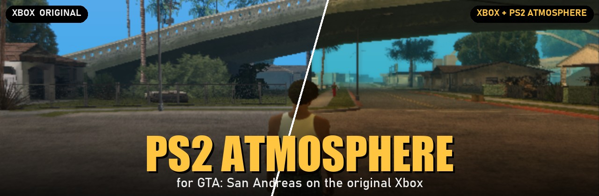
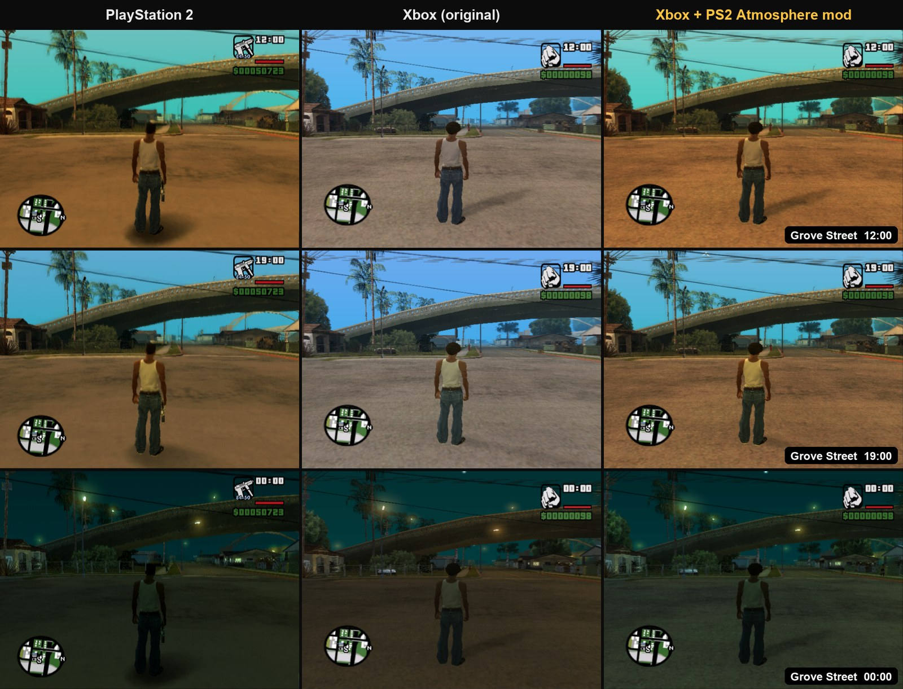
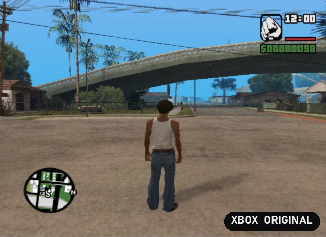
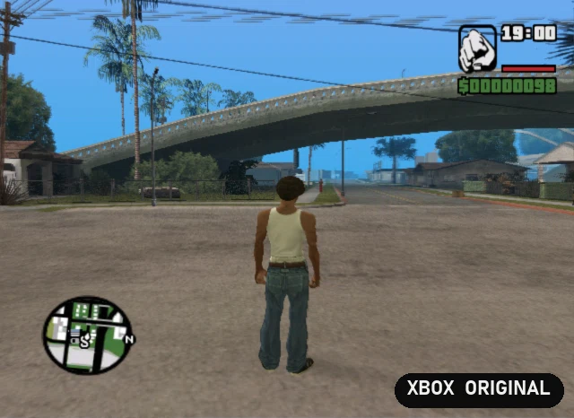
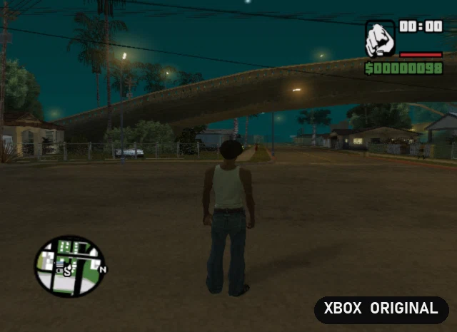
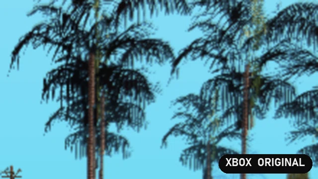
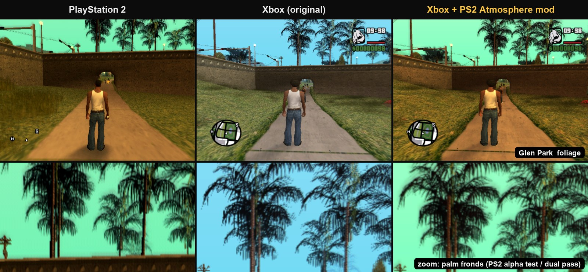
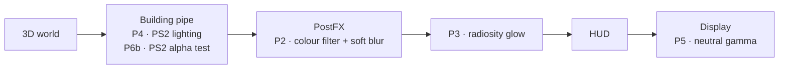

<p align="center">
  
</p>

<h3 align="center">The orange haze is back.</h3>

<p align="center">
  A binary patch that gives the original-Xbox <i>GTA: San Andreas</i> the look of the PS2 version<br>
  and keeps everything the Xbox does better.
</p>

<p align="center">
  <a href="https://github.com/SalustLab/GTA_SA_PS2ToXboxExperience/releases/latest"></a>
  
  
  <br>
  
  
  
  
</p>

<p align="center">
  <a href="#see-it">See it</a> ·
  <a href="#install">Install</a> ·
  <a href="#compatibility">Compatibility</a> ·
  <a href="#how-it-works">How it works</a> ·
  <a href="#for-tinkerers">For tinkerers</a> ·
  <a href="#credits">Credits</a>
</p>

---

## Why this exists

If you played San Andreas on a PS2, you remember the air. The orange haze over Los Santos at sunset, the soft glow on every bright wall, that slightly dreamy blur over everything.

The Xbox port is the sharper version: better textures, longer draw distance, 480p. But it lost the mood. Daylight goes grey and sunsets go flat.

I wanted both, so I took the game apart.

The first surprise: `timecyc.dat`, the file that holds the colours for every hour and every weather, is **byte-identical on both consoles**, and so are the other assets. The difference is all in the engine code. Here is what the Xbox build does differently:

- it blends the colour filter with a different formula;
- it runs an extra blur pass that washes the filter out;
- it ships with radiosity off;
- it lights buildings differently;
- it treats foliage transparency its own way.

**PS2 Atmosphere** is a set of small, surgical x86 patches to `default.xbe` that put the PS2 behaviour back. Each one was checked against PS2 captures of the same frozen scene.

## See it

<p align="center">
  
  <br><sub>Grove Street, same spot, same weather, clock frozen. Left to right: <b>PS2</b> · <b>Xbox original</b> · <b>Xbox + PS2 Atmosphere</b>.</sub>
</p>

Each loop below flips between the original Xbox and the patched game on the exact same frame:

| Noon | Golden hour |
|:---:|:---:|
|  |  |
| **Midnight** | **Palm canopies (zoomed)** |
|  |  |

<p align="center">
  
  <br><sub>Glen Park. The Xbox cuts palm fronds into hard, broken shapes; the PS2 alpha test keeps them full and soft. The patch draws them the PS2 way.</sub>
</p>

## What changes, what stays

<table>
<tr>
<td width="50%" valign="top">

**What you get from the PS2**
- The colour filter: the warm orange (or green, or grey) grade from `timecyc.dat`, at full strength
- The soft blur on that filter
- The radiosity glow on bright surfaces
- PS2 building lighting: stronger ambient light, softer baked light
- Full, continuous foliage, palm fronds and power lines
- A neutral display gamma at the default brightness

</td>
<td width="50%" valign="top">

**What you keep from the Xbox**
- DXT textures
- Longer draw distance (LODs)
- 480p output
- The Xbox car reflection shader
- Your saves: the patch doesn't touch them

</td>
</tr>
</table>

## Install

You need **your own** copy of GTA San Andreas, **USA, Rev 1**. The installer checks `default.xbe` against SHA1 `10EFB868F13D6944AA6684A52CAC5156393F14C5` and won't touch anything else.

1. Grab **`SA-PS2Atmosphere-v1.0.zip`** from [Releases](https://github.com/SalustLab/GTA_SA_PS2ToXboxExperience/releases/latest) and unzip it.
2. Get [xdelta3](https://github.com/jmacd/xdelta-gpl/releases) and drop `xdelta3.exe` into that folder.
3. Point the installer at your game: either a folder (`default.xbe` + `stream.ini`, for example copied off the Xbox over FTP) or an `.iso` / `.xiso`, for example the one you load in xemu.

   ```
   py apply_patch.py "D:\Games\GTA San Andreas"
   py apply_patch.py "D:\xemu\GTA San Andreas.iso"
   ```

Before it writes a single byte, the installer checks both files and saves the originals as `.bak` (a full copy for an ISO). After patching, it verifies the result. Running it twice just says `already patched`.

No Python? Apply `default.xbe.xdelta` with any xdelta GUI and edit five lines of `stream.ini` in Notepad. The step-by-step is in [`release/README.md`](release/README.md).

> [!TIP]
> Keep **Brightness** at its default. Saves remember their own brightness, so hit *restore defaults* in the Display menu once. The neutral gamma is calibrated for that setting.

## Compatibility

| Setup | Status |
|---|---|
| GTA San Andreas, USA, Rev 1 | Supported (the only accepted input) |
| [xemu](https://xemu.app) | Tested: boots, loads saves, all patches live |
| Softmodded / modchipped Xbox | Expected to work: the patched XBE loses its retail signature, which these consoles don't check |
| Real hardware | Not tested yet. Reports are very welcome. |
| Other regions (PAL, NTSC-J), Rev 0 | Not supported: different binaries; the installer refuses them |
| Stock, unmodded console | Not supported: won't boot an unsigned XBE |

## How it works

Everything happens inside one frame of the game's renderer. Each patch replaces Xbox code in place, usually inside the original function's own bytes, so the file size never changes.



| Patch | What it does | How I checked it |
|---|---|---|
| **P2** | PS2 colour-filter formula and its soft blur; also turns off the Xbox blur pass that washed it out (this supersedes the first version, P1) | 99 % of pixels within ±2 of the predicted PS2 result, in the booted game |
| **P3** | PS2 radiosity (the fixed-function path documented by SkyGfx), intensity calibrated against the PS2 | 100 % of pixels within ±2 of the model, in the booted game |
| **P4** | PS2 building lighting on the building pipes only: baked light ×0.91 (the night set a further ×0.80), ambient ×1.8 | Fitted to paired PS2/Xbox captures, day and night |
| **P5** | Default brightness becomes an identity gamma ramp, as on the PS2 | Noon frame colour error vs PS2: ΔE 5.7 → 1.0 |
| **P6b** | Foliage drawn with PS2 alpha-test semantics (a dual pass) | Only alpha-tested textures change (1.7–3.9 % of pixels); opaque geometry is identical |

Plus five `stream.ini` values: the blur offsets go from `16` to `8`, and radiosity is switched on.

The full research is public in this repo: [`docs/PLAN.md`](docs/PLAN.md) has the plan, hypotheses and roadmap, and [`docs/findings.md`](docs/findings.md) is the dated lab log of every address, experiment and verdict.

## Known limits & what's next

- **Night streets** come out a touch brighter than on the PS2. I traced most of it to the Xbox asphalt texture itself, which is about 6 % brighter than the PS2's. That's game data, not code, and this project keeps the Xbox textures, so I left it alone.
- **Grass**: I built a PS2-accurate grass tweak, put it side by side with the stock grass, and liked the Xbox grass better. The mechanism is documented in the lab log, but it isn't shipped.
- **Real hardware**: everything was tested in xemu. A run on a softmodded console is next on my list.
- **Other versions**: only USA Rev 1 for now. Another region would need its own address map.

## For tinkerers

<details>
<summary><b>Build it yourself, poke at it, break it</b></summary>

### Requirements

- Your own dump of `default.xbe`, USA Rev 1 (SHA1 above). Every tool refuses any other input.
- Python 3.13 with `capstone`, `pefile`, `pillow`, `numpy` and `keystone-engine`.
- For live testing: xemu with its GDB stub, and PCSX2 with PINE for the PS2 reference.

No game data lives in this repo. Patch JSONs guard the original bytes with a SHA1 (`orig_sha1`) instead of storing them.

### Patch pipeline

```sh
py patches/p2_filterblur.py          # each generator assembles its patch (keystone) and writes the JSON
py tools/xbe_patch.py work/xbox/default.xbe dist/default_p2p3p4p5p6b.xbe \
   patches/p2_filterblur.json patches/p3_radiosity.json patches/p4_building_ambient.json \
   patches/p5_display_gamma.json patches/p6b_dualpass.json
```

`xbe_patch.py` refuses a wrong input hash, targets in BSS, overlapping patches, any mismatch in the original bytes, and patches whose `requires` are missing (P6b needs P2). Every script has a self-check: `py <script> --selftest`.

### Building the release

```sh
xdelta3 -e -9 -S none -A=default.xbe//default.xbe/ -f -s work/xbox/default.xbe dist/default_p2p3p4p5p6b.xbe dist/SA-PS2Atmosphere/default.xbe.xdelta
cp release/README.md release/apply_patch.py xdvdfs_extract.py dist/SA-PS2Atmosphere/
py -m zipfile -c dist/SA-PS2Atmosphere-v1.0.zip dist/SA-PS2Atmosphere
```

### Tools

| Script | Purpose |
|---|---|
| `tools/xbe_patch.py` | Applies patch JSONs to `default.xbe`, with every safety check above |
| `tools/xemu_gdb.py` | Live pokes and captures through the xemu GDB stub: clock, weather, teleport, timescale, idle cam, capture |
| `tools/pcsx2_pine.py` | The same for the PS2 through PCSX2 PINE |
| `tools/compare.py` | Capture metrics against the PS2 reference, with diff images |
| `tools/predict_filter.py` | Expected PS2 / Xbox colour-filter output for a frame |
| `tools/ps2_cheats.pnach` | Alternative PS2 clock and weather freeze |
| `xdvdfs_extract.py` | Extracts or lists an Xbox XDVDFS image (7-Zip misreads the format) |
| `release/apply_patch.py` | The player-facing installer |

### Layout

- `patches/`: one generator script per patch, plus its JSON.
- `tools/`: patcher, metrics and the live-memory helpers for both emulators.
- `release/`: installer and player README.
- `docs/`: plan, lab log, and the media on this page.

</details>

## Credits

- **aap**, for [SkyGfx](https://github.com/aap/skygfx): that research into how the PS2 renders San Andreas is the reference this whole project is measured against.
- The [gta-reversed](https://github.com/gta-reversed/gta-reversed) project, for mapping the engine.
- [xemu](https://xemu.app) and [PCSX2](https://pcsx2.net), the two emulators every test in this project ran on.
- [xdelta](https://github.com/jmacd/xdelta), for the patch format.

## Legal

This is a fan project. It is not affiliated with or endorsed by Rockstar Games or Take-Two Interactive. *Grand Theft Auto* and *San Andreas* are their trademarks.

The repository and releases contain **no game code or assets**: the patch is a diff that only applies to your own legally dumped copy, and every tool refuses anything else. Screenshots are shown for comparison. The code in this repository is released under the [MIT License](LICENSE).

<p align="center"><sub>Made solo by <b>SalustLab</b>, one patch at a time.</sub></p>
